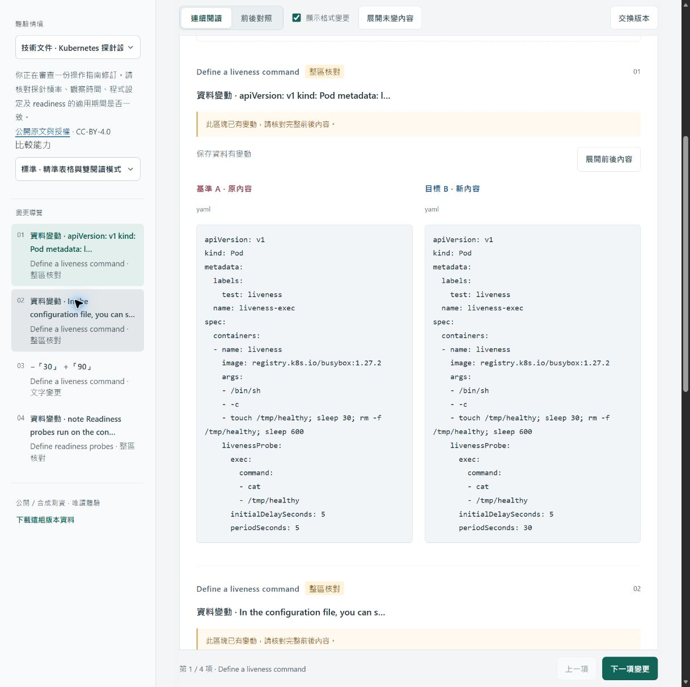

# 版本之間 · Lexical Snapshot Compare

讓審查者從兩份保存文件找到變更，並知道哪些部分仍不能下結論。包含可操作的繁中介面、唯讀比較核心、真正的 Lexical 0.18 JSON 解析、公開文章案例及公司 Agent 接入契約。

**公司內 Agent 從 [AGENT-HANDOFF.md](docs/AGENT-HANDOFF.md) 開始。** 本套件可直接驗證與呼叫比較核心；正式產品的 node registry、身分持久化、版本 API、renderer 與權限仍須在公司內查證，不是免調整的產品外掛。



## 五分鐘本機試用

Node 22.13+（已在 Node 22／24 驗證）；首次安裝需 npm registry，之後測試與 UI 不需外網。

```sh
npm ci
npm run verify
npm start
```

開啟 http://127.0.0.1:4175 。不會取得公司資料或呼叫外部 AI，也不會在開啟歷史媒體時偷偷載入目前媒體冒充舊版。

- **公開技術文章**：Kubernetes 探針設定，含完整文章、六份固定版本 YAML、程式碼、混合格式、引用及清單。保留未展開網站標記並記錄轉錄限制。
- **公開規範文章**：CNCF 繁體中文社群行為準則，含禁止事項、回覆期限、連結及修訂權限。
- **擴充演練**：新增 callout handler／renderer，未改配對核心。側欄可切換標準、保守、精簡設定；切設定會開始新比較 session。
- **45 組既有合成情境**：12章上線文件、38列對照表、長 URL、image、video、合併表格、Mermaid、quote、collapse、未知節點及故障反例。

公開文章的 B 版是刻意製作的審查演練，**不是上游真實修訂史，也不能當操作或規範建議**。原文來源、commit、授權與 SHA-256 見 [來源清單](corpus/SOURCES.json)；修訂答案在 [snapshots](corpus/snapshots/)，建議試用前不要先看答案。

## 實際 JSON 路徑

```text
保存的 Lexical JSON + 同版 identity sidecar
  → 以 host 提供的 disposable editor.parseEditorState 真正解析
  → 比對 runtime re-export，揭露被丟棄／改寫的欄位
  → 從原始保存 JSON 建立比較副本（不拿 re-export 取代原文）
  → 唯讀比較結果、限制分類、導覽與前後呈現
```

Markdown 只用於製作公開文章測資；正式比較不經 Markdown／HTML round-trip。公開文章原始 JSON 無自訂 `blockId` 污染，身分存在 `identity.nodes`，比較時才加到副本。**缺 ID 不從位置／文字猜配對。** Sidecar 的 path 只定位「這一版」的 node，跨版本關聯依儲存的 ID；正式保存流程仍須實作／查證此契約。

```js
import {compareSnapshots} from './dist/reference/index.js';
import {createReferenceEditor} from './dist/reference/registry.js';

const result = compareSnapshots(savedA, savedB, {
  createEditor: createReferenceEditor, // 只適用本套件標準0.18節點；公司需換成實際registry
});
// 先處理 failed／partial 及 diagnostics，再呈現 records。
// ready 只代表資料與runtime檢查就緒，不代表每個區塊都可精準比較或可核准。
```

```sh
npm run compare -- corpus/snapshots/article-tech.a.json corpus/snapshots/article-tech.b.json
```

CLI exit code：0 runtime檢查就緒、2 輸入／執行失敗、3 部分可讀但有診斷；區塊自己的 coarse／unverified 判定仍需查看。自訂 registry 使用 `--registry ./host-registry.mjs`，該模組必須匯出 `createEditor(onError)`。只載入你信任的公司模組。

## 帶回公司需讀的文件

| 文件 | 用途 |
| --- | --- |
| [Agent 交接指令](docs/AGENT-HANDOFF.md) | 直接交給公司 Agent；先盤點，再走最小接入切片 |
| [接入與調整契約](docs/INTEGRATION.md) | API、版本／ID、registry、renderer、權限與失敗邊界 |
| [功能檢核表](docs/FEATURE-CHECKLIST.md) | 現行能力逐一列出可接受／不可接受與證據方式 |
| [正式驗收標準](docs/ACCEPTANCE.md) | 27條標準；D/P/H/I四種證據不可混淆 |
| [本輪 TypeScript Review](docs/REVIEW-TYPESCRIPT.md) | 測試、真實畫面、修正與剩餘缺口 |
| [Review 模板](docs/REVIEW-TEMPLATE.md) | 每次方案／實作變更均需填寫 |
| [授權與來源](THIRD-PARTY-NOTICES.md) | 公開文章、轉錄與程式碼的授權界線 |

`src/` 是 strict TypeScript 來源；`dist/` 全部由 build 生成，含型別宣告，禁止手改。`src/core` 是純比較核心，`src/ui` 是 vanilla DOM 參考介面，尚未封裝成 React component。公司可沿用視覺與互動契約，以現有 renderer 實作 UI。`createComparisonController` 提供非同步 loading、拒絕過期回覆與 revision 身分核對；它不實作公司授權。

`npm run corpus:build` 可從固定來源離線再生 JSON；`npm run corpus:check` 驗證來源雜湊及所有生成物無漂移。`npm run verify` 包含此檢查、引擎、runtime、控制器及既有反例測試。GitHub CI 在 Node22／24 執行相同指令。

驗證支持的是本套件的行為。正式 Lexical custom-node 相容性、使用者理解／速度、美感感受與權限正確性，需要公司內證據。不得以本套件測試通過代替產品驗收。

擴充與功能開關依 [X1–X8契約](docs/EXTENSION-CONTRACT.md) 驗收；`npm run lint` 已加入 verify 與 CI。目前 v0.2 已完成 strict TypeScript runtime、handler registry、集中 policy resolver；沒有遷移例外。新增節點與功能開關請從 [維護與擴充指南](docs/MAINTENANCE.md) 開始。
